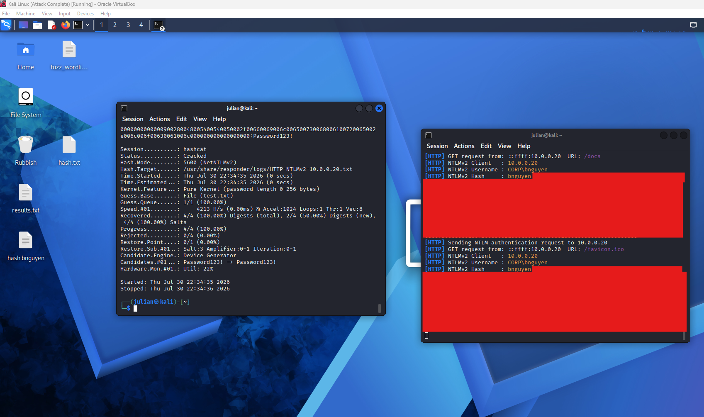
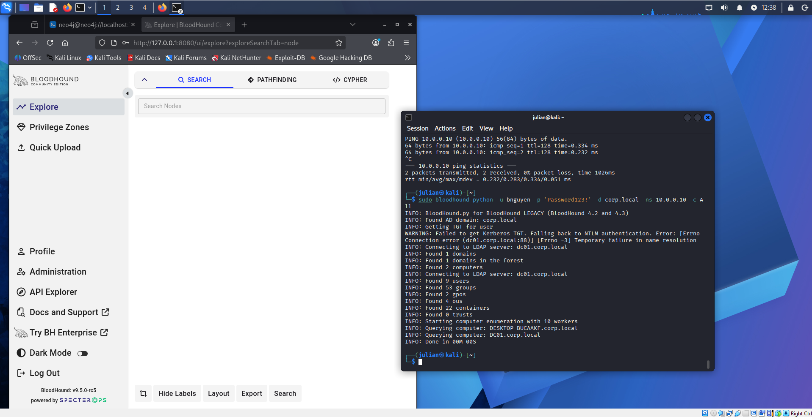
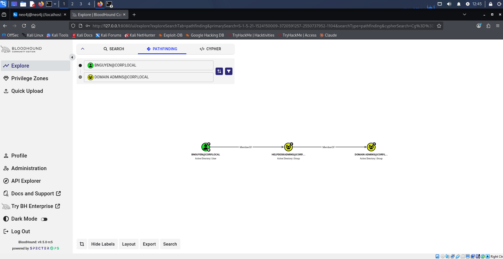
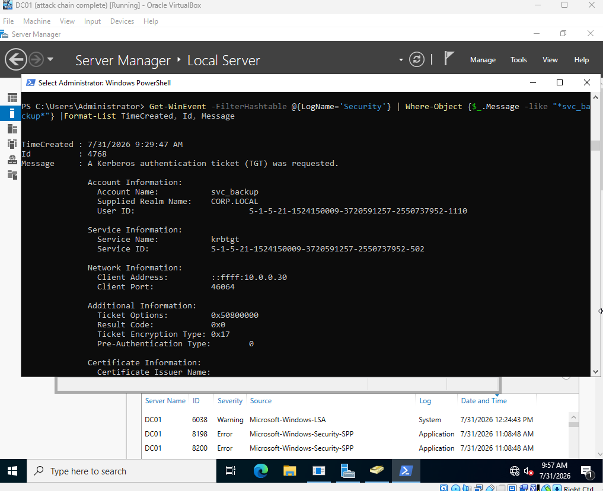
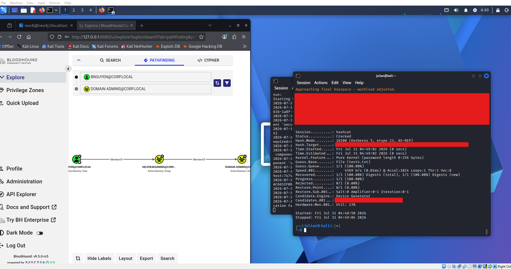
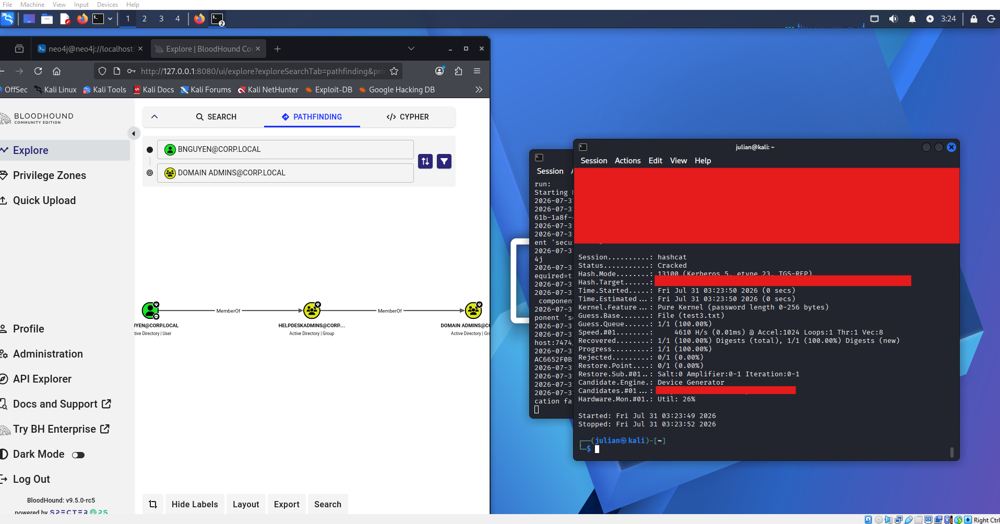
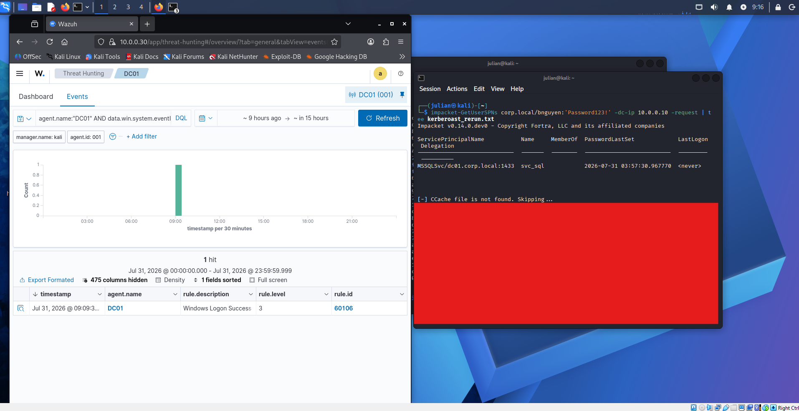
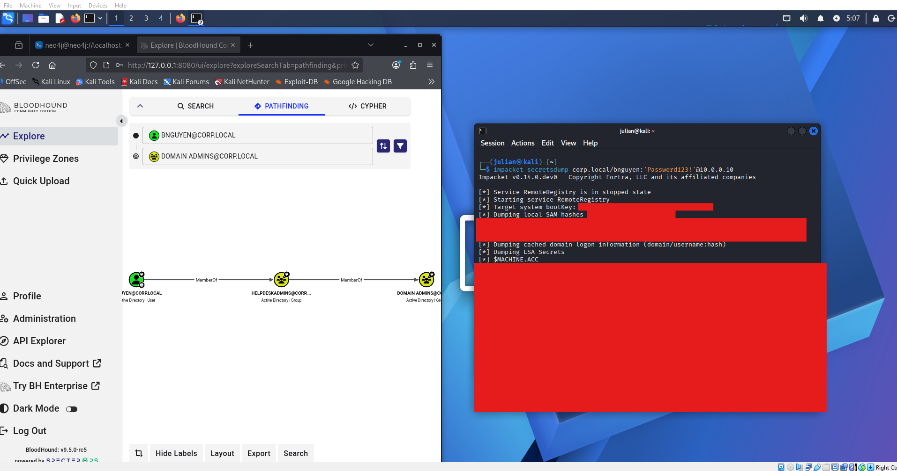
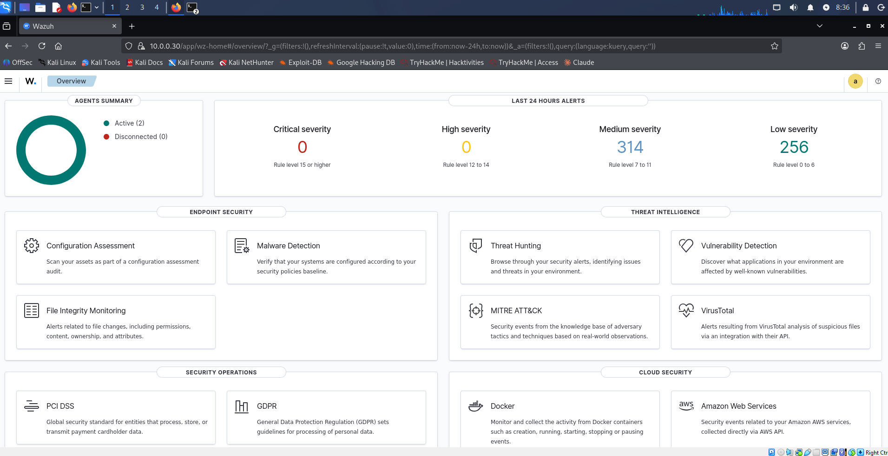

# Active Directory Attack & Defend: From Zero to Domain Admin (and Catching It — Mostly)

I'm a Computer Science student majoring in Cyber Security, and I wanted to learn active directory so I built a small Active Directory domain from scratch (corp.local), gave it a few realistic misconfigurations, attacked it end-to-end from zero access to full domain compromise, and then put a Wazuh SIEM on top of it to see what it would actually catch. Spoiler, not much.

**Lab environment:** Self-hosted AD domain in VirtualBox on a host-only 10.0.0.0/24 network — a Kali attack box, a Windows Server 2022 domain controller, a Windows 11 client, and Wazuh 4.9 monitoring both Windows hosts.

## Why I built it this way

Most write-ups I see show a single exploit in isolation and stop there. I wanted to chain the real techniques an attacker would actually use against a domain, poison traffic, crack a hash, enumerate the domain, escalate privileges through Kerberos abuse, and dump every credential I could and then turn around and ask the question that actually matters for a defensive role, "would my SIEM have caught this?"

Where the answer was no, I kept that in the write-up instead of editing it out. A write-up that says "heres where it failed and why" is more useful to show an employer I actually understand the defensive side, not just the offensive one.

## Lab topology

DC01 (Windows Server 2022): Domain Controller for corp.local
CLIENT01 (Windows 11 Enterprise): Domain-joined workstation
Kali (Kali Linux): Attack platform

**Tools I used to attack:** Responder, Impacket (GetNPUsers, GetUserSPNs, secretsdump, lookupsid), BloodHound Community Edition (bloodhound-python), Hashcat

**What I used to defend:** Wazuh 4.9 SIEM, with agents on DC01 and CLIENT01 watching Windows Security event logs

## The attack chain, start to finish

```
Unauthenticated network position
        │
        ▼
[1] LLMNR/NBT-NS Poisoning  →  NTLMv2 hash captured  →  cracked (bnguyen)
        │
        ▼
[2] BloodHound Enumeration  →  bnguyen → HelpDeskAdmins → Domain Admins
        │
        ▼
[3] AS-REP Roasting          →  further credential material captured
        │
        ▼
[4] Kerberoasting            →  svc_sql service account hash captured & cracked
        │
        ▼
[5] Credential Dumping (secretsdump)  →  SAM hashes, LSA secrets, krbtgt hash
        │
        ▼
Full domain compromise
```
## 1. LLMNR/NBT-NS Poisoning

**MITRE ATT&CK:** [T1557.001 — Adversary-in-the-Middle: LLMNR/NBT-NS Poisoning and SMB Relay](https://attack.mitre.org/techniques/T1557/001/)

Windows falls back to LLMNR/NBT-NS broadcast name resolution whenever DNS fails to resolve something which happens all the time in real networks due to things like typos, stale entries or a mistyped share path. If I'm sitting on the same broadcast domain, I can just answer that broadcast query myself and pretend to be whatever resource the victim was actually looking for.

I ran Responder on my Kali box in analyze/poison mode, listening on the lab's host-only interface. A client request for a resource that didn't exist (fileshare02.local) got poisoned, and I captured the client's NTLMv2 challenge-response hash the moment it tried to authenticate against the fake resource Responder presented.

I cracked the captured hash offline with Hashcat and got valid domain credentials for "bnguyen".



**What Wazuh caught:** Nothing. However I came to find its a pretty common thing as catching LLMNR poisoning generally needs either network level IDS watching for broadcast protocol abuse or a purpose built correlation rule, and neither was part of my baseline setup. I flagged this as finding #1 below rather than quietly leaving it out.


## 2. Enumeration with BloodHound

**MITRE ATT&CK:** [T1087.002 — Account Discovery: Domain Account](https://attack.mitre.org/techniques/T1087/002/), [T1069.002 — Permission Groups Discovery: Domain Groups](https://attack.mitre.org/techniques/T1069/002/)

With bnguyen's credentials in hand, I ran bloodhound-python against the domain controller to map out the whole domain, every user, group, who's a member of what, who has permissions over what, and how it all connects.

I also ran impacket-lookupsid separately to brute-force the domain's internal ID numbers to confirm the exact identity of key accounts (Administrator, krbtgt, Domain Admins, the service accounts) before going any further.

Once the graph was loaded into BloodHound CE, I queried it for the shortest path from my compromised account to Domain Admins, and ended up with this:

```
bnguyen  --MemberOf-->  HelpDeskAdmins  --MemberOf-->  Domain Admins
```





A standard user account, nested through a single group membership, straight into Domain Admins. This is the kind of thing that can find its way into real environments for example someone adds the helpdesk group to a privileged group "just for now" and nobody ever takes it back out and it's basically invisible unless you're looking at the graph rather than a flat permissions list.

**What Wazuh caught:** Nothing here either. LDAP enumeration like this is mostly passive, so it didn't trip anything. I'm counting this as finding #2 - monitoring for BloodHound's characteristic LDAP (protocol used to query Active Directory's directory of users/groups/computers) query volume/pattern is a well known SIEM rule to add, and I just hadn't built it yet.

## 3. AS-REP Roasting

**MITRE ATT&CK:** [T1558.004 — Steal or Forge Kerberos Tickets: AS-REP Roasting](https://attack.mitre.org/techniques/T1558/004/)

AS-REP roasting goes after accounts that have Kerberos pre-authentication disabled. For those accounts, I can request an AS-REP for the user without supplying any password at all, and what comes back is encrypted with that user's password hash which I can then try to crack offline.

I used impacket-GetNPUsers to find and request AS-REP material for the vulnerable account (svc_backup), and confirmed it independently by pulling the matching Kerberos TGT (ticket granting ticket) request (Event ID 4768) straight from DC01's Security log. I cracked the resulting hash offline with Hashcat.





**What Wazuh caught:** This was the most interesting result of the whole project. I could see the attack clearly at the source - Event ID 4768 on DC01 showed the request plainly, account name and all but it never showed up in the Wazuh dashboard. I lost way too much time tracing this down before realizing the raw log was being ingested fine there just wasn't a rule mapped to correlate a pre-auth-disabled AS-REP request into something alertable. The data was there, the rule just wasn't. Whoops.

## 4. Kerberoasting

**MITRE ATT&CK:** [T1558.003 — Steal or Forge Kerberos Tickets: Kerberoasting](https://attack.mitre.org/techniques/T1558/003/)

Any authenticated domain user can request a Kerberos service ticket for any registered SPN (service principal name. A label that tells Kerberos "this account runs this service"), and that ticket comes back encrypted with the service account's own password hash. Service accounts tend to have weak, rarely rotated passwords since no one logs into them interactively which makes this attack quiet and high value.

I ran impacket-GetUserSPNs with bnguyen's credentials to enumerate SPNs and request tickets for each one. One result jumped out immediately:

```
ServicePrincipalName          Name      PasswordLastSet
MSSQLSvc/dc01.corp.local:1433 svc_sql   2026-07-31
```

I pulled the svc_sql ticket in crackable hashcat format (mode 13100) and cracked it offline, recovering the service account's plaintext password.



**What Wazuh caught:** This finally got something. The dashboard flagged the Kerberoasting attempt, correlating the TGS request against Event ID 4769 and the RC4 (0x17) encryption type a solid signal since AES is the modern default, so a legacy RC4 ticket request stands out. I was glad to have at least one clean result to set against the misses above it shows the SIEM wasn't just broken across the board, it had specific, identifiable gaps rather than zero coverage.



Small note: the alert initially looked like it happened 8 hours before I actually ran the attack. Turned out my analyst machine was on AEST and the attack VM's clock was set to UTC-8 so not a detection bug, just me forgetting to check timezones before chasing a phantom problem.

## 5. Credential Dumping - secretsdump

**MITRE ATT&CK:** [T1003.002 — OS Credential Dumping: Security Account Manager](https://attack.mitre.org/techniques/T1003/002/), [T1003.004 — OS Credential Dumping: LSA Secrets](https://attack.mitre.org/techniques/T1003/004/)

With the cracked svc_sql credentials (and the escalated access that came with them), I ran impacket-secretsdump directly against DC01. That pulled:

- Local SAM hashes (local database on windows machine that stores account password hashes) (Administrator, Guest, DefaultAccount)
- Cached domain logon information
- LSA (local security authority. Handles logins and stores secrets in memory/registry) secrets, including the machine account secret and DPAPI (windows built in encryption system) system keys
- The krbtgt account hash, the single most sensitive credential in the entire domain, since it signs every Kerberos ticket issued. Having this is what lets an attacker forge a Golden Ticket: a TGT for any account, including Domain Admin, with no further authentication, valid until the krbtgt password gets rotated (twice).

At this point it's full domain compromise. Everything needed to persist indefinitely and move anywhere in the domain is sitting in that dump.



**What Wazuh caught:** Nothing again. Catching remote SAM/LSA dumping like this usually needs SACL auditing on sensitive objects (feeding Event ID 4662) or behavioral monitoring on the remote registry service, and I hadn't configured either.

## Detection Scorecard



- LLMNR/NBT-NS Poisoning: Not caught by Wazuh
- BloodHound Enumeration: Not caught by Wazuh
- AS-REP Roasting: Not caught by Wazuh
- Kerberoasting: Caught by Wazuh
- secretsdump: Not caught by Wazuh

4 out of 5 stages went undetected. Kerberoasting was the only one that actually got flagged.

## What I'd fix next

- Write custom Wazuh rules/decoders for LLMNR/NBT-NS abuse and anomalous NTLM auth patterns
- Correlate Event ID 4768 against pre-auth-disabled accounts so AS-REP roasting specifically gets flagged, not just any TGT request
- Turn on SACL auditing for krbtgt, Domain Admins, and other Tier 0 objects to get 4662 events feeding a secretsdump/DCSync detection rule
- Build a rule for BloodHound-style LDAP enumeration (query volume/breadth from one account in a short window)
- Pull HelpDeskAdmins out of Domain Admins and re-run the BloodHound graph to confirm the path's actually closed
- Rotate the krbtgt password (twice, properly spaced) since it got captured during this exercise

## Tools I used

Responder, BloodHound CE (bloodhound-python), Impacket (GetNPUsers, GetUserSPNs, secretsdump, lookupsid), Hashcat, Wazuh 4.9
